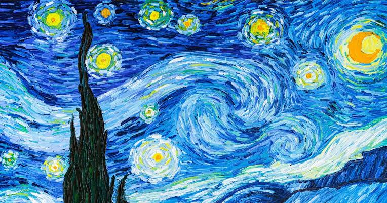
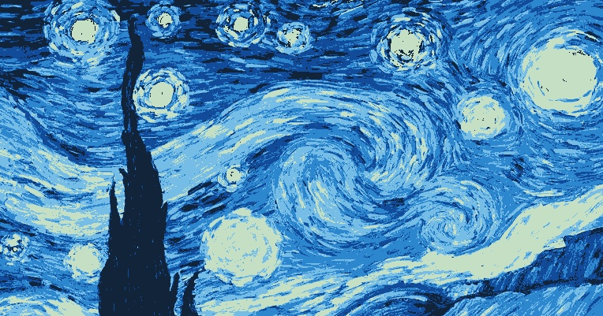

# image-color-quantization

**Project motivation:** This project is an implementation of the kmeans algorithm to perform image color quantization and reduce the colors in the image to a smaller (K) number of colors. This uses opencv to read the image, and is somewhat based on the cv2.kmeans() function.  Color quantization can serve several purposes, for example, to decrease the number of distinct colors in an image while preserving its overall visual appearance as closely as possible. This can be helpful in situations like hardware limitations on devices which can only display a limited number of colors, compressing an image's file size, or as an artistic/visual effect.


### Run:
Install the OpenCV Windows .exe from https://opencv.org/releases/ to use OpenCV with MSVC and CMake

Then run,
```
# Build w/out OpenMP
cmake -B build -DUSE_OPENMP=OFF
cmake --build build

# Build w/ OpenMP
cmake -B build -DUSE_OPENMP=OFF
cmake --build build

# Run
.\build\Debug\color_quantization.exe <full_path_to_image>                                                                                               # eg: .\build\Debug\color_quantization.exe C:\Users\Judyc\VSProjects\color-quantization\image.jpeg                                                                                                                           
```

And update `option(USE_OPENMP "Build with OpenMP" [ON/OFF])` in CMakeLists.txt


### Benchmarks after parallelization
After parallelizing with OpenMP, the running time (benchmarked with chrono time library):

`image1.jpg` 306364 total pixels --> speedup of 4.45x
* Running parallelized `b_openmp_kmeans.cpp` on `image.jpeg` 5 times (in ms) = 260, 272, 258, 241, 248 = average 255.8 ms
* Running normal `b_openmp_kmeans.cpp` on `image.jpeg` 5 times (in ms) = 1139, 1098, 1210, 1147, 1092 = average 1137.2 ms


`image2.jpg` 634880 total pixels --> speedup of 4.66x
* Running parallelized `b_openmp_kmeans.cpp` on `image2.jpg` 5 times (in ms) = 528, 524, 491, 509, 493 = average 509.0 ms
* Running normal `b_openmp_kmeans.cpp` on `image.jpg` 5 times (in ms) = 2307, 2376, 2383, 2614, 2192 = average 2374.4 ms


### Example images:
#### `image.jpeg`
Before:



After:



#### `image2.jpg`

Before:


After:


### References + Credits
https://stackoverflow.com/questions/49710006/fast-color-quantization-in-opencv
https://github.com/Aftaab99/ImageColorQuantization/blob/master/KMeansCompressv2.cc
https://arxiv.org/abs/2405.12052
https://www.krtk.app/blog/06-openmp-kmeans
