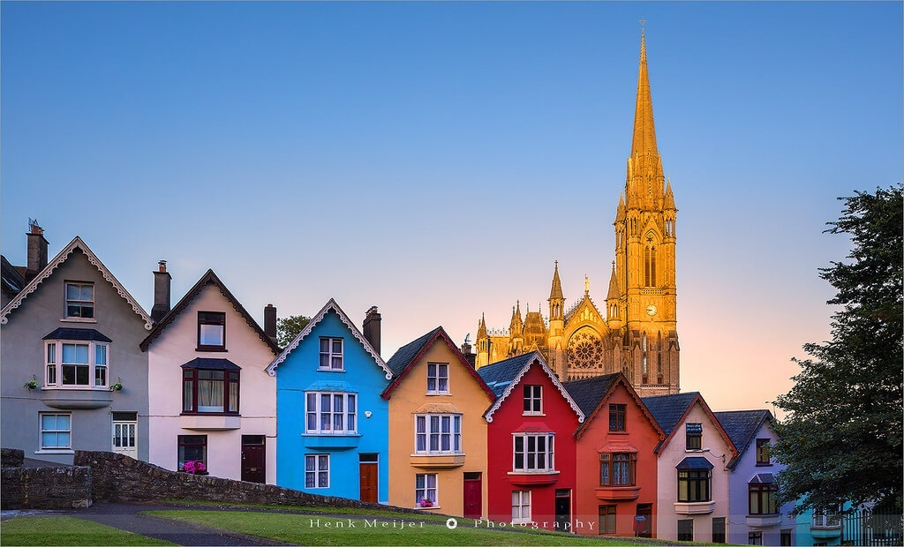
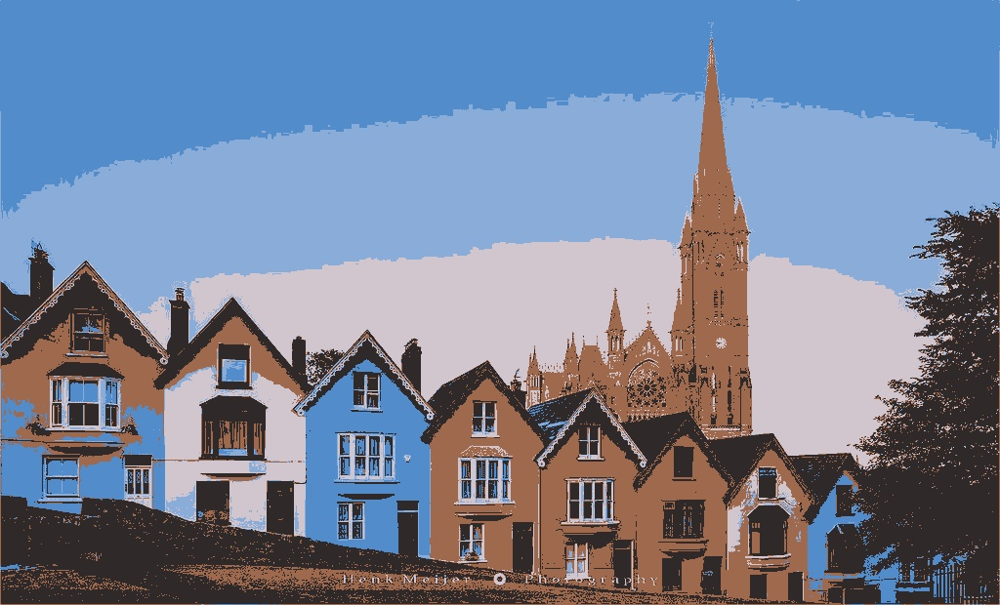

# image-color-quantization

**Project motivation:** This project is an implementation of the kmeans algorithm to perform image color quantization and reduce the colors in the image to a smaller (K) number of colors. This uses opencv to read the image, and is somewhat based on the cv2.kmeans() function.  Color quantization can serve several purposes, for example, to decrease the number of distinct colors in an image while preserving its overall visual appearance as closely as possible. This can be helpful in situations like hardware limitations on devices which can only display a limited number of colors, compressing an image's file size, or as an artistic/visual effect.


### How to run:
Install the OpenCV Windows .exe from https://opencv.org/releases/ to use OpenCV with MSVC and CMake

Then run,
```
# Build w/out OpenMP
cmake -B build -DUSE_OPENMP=OFF
cmake --build build

# Build w/ OpenMP
cmake -B build -DUSE_OPENMP=OFF
cmake --build build

# Run
.\build\Debug\color_quantization.exe <full_path_to_image> <K> <num_iterations>
```

And update `option(USE_OPENMP "Build with OpenMP" [ON/OFF])` in CMakeLists.txt


### Example images:
K = 5 
#### `image.jpeg`
Before:


After:


#### `image2.jpg`

Before:



After:




### Benchmarks
This was the running time (benchmarked with chrono time library):

`image.jpeg`: 306364 total pixels, K = 5, iterations = 5, running with 12 cores --> for median time, the program achieved a speedup of 4.00x over normal, and 4.58x over cv2.kmeans()
* Running parallelized `b_openmp_kmeans.cpp` on `image.jpeg` 20 times: 
    * Best time (in ms): 227
    * Median time (in ms): 239
    * Mean time (in ms): 243.5
* Running normal `b_openmp_kmeans.cpp` on `image.jpeg` 20 times:
    * Best time (in ms): 893
    * Median time (in ms): 957
    * Mean time (in ms): 970.55
* Using OpenCV's cv2.kmeans() function `cv2.cpp` 20 times: 
    * Best time (in ms): 953
    * Median time (in ms): 1094
    * Mean time (in ms): 1151.9

`image2.jpg`: 634880 total pixels, K = 5, iterations = 5, running with 12 cores --> for median time, the program achieved a speedup of 4.10x over normal, and 5.14x over cv2.kmeans()
* Running parallelized `b_openmp_kmeans.cpp` on `image2.jpg` 20 times (in ms):
    * Best time (in ms): 473
    * Median time (in ms): 491
    * Mean time (in ms): 505.65
* Running normal `b_openmp_kmeans.cpp` on `image.jpg` 20 times (in ms):
    * Best time (in ms): 1804
    * Median time (in ms): 2015
    * Mean time (in ms): 2016.75
* Using OpenCV's cv2.kmeans() function `cv2.cpp` 20 times:
    * Best time (in ms): 2190
    * Median time (in ms): 2526
    * Mean time (in ms): 2699.4

### Larger image
I hypothesized a larger image would allow for more speedup and decrease the impact of having to allocate threads and overhead when using OpenMP


`4k_image.jpg`
14897670 total pixels, averaged over 5 trials, iterations = 5, k = 5

With OpenMP:
* Best time (in ms): 10432
* Median time (in ms): 12031
* Mean time (in ms): 11922.6

Without:
* Best time (in ms): 48766
* Median time (in ms): 54415
* Mean time (in ms): 60450.4

54415/12031 = 4.5x speedup for median time

### increased K = 12
`image.jpeg` with iterations =5, k =12

With OpenMP:
* Best time (in ms): 481
* Median time (in ms): 488
* Mean time (in ms): 487.2

Without:
* Best time (in ms): 2234
* Median time (in ms): 2281
* Mean time (in ms): 2276.2

2281/488 = 4.67x speedup, which is a big differnce from the 4.00x difference above.


### References + Credits
https://stackoverflow.com/questions/49710006/fast-color-quantization-in-opencv

https://github.com/Aftaab99/ImageColorQuantization/blob/master/KMeansCompressv2.cc

https://arxiv.org/abs/2405.12052

https://www.krtk.app/blog/06-openmp-kmeans
